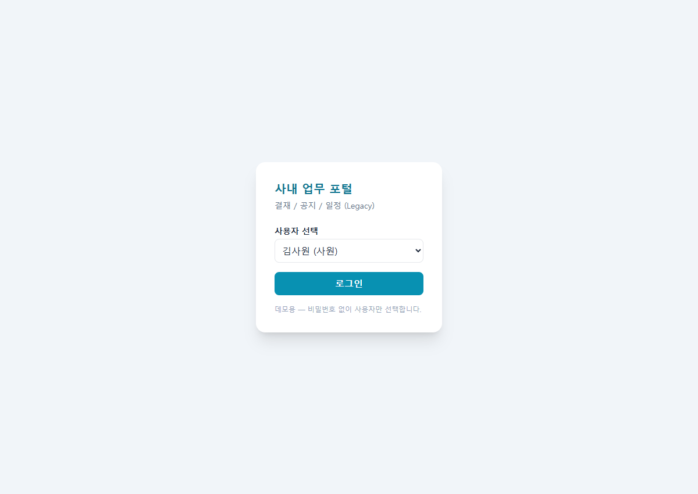
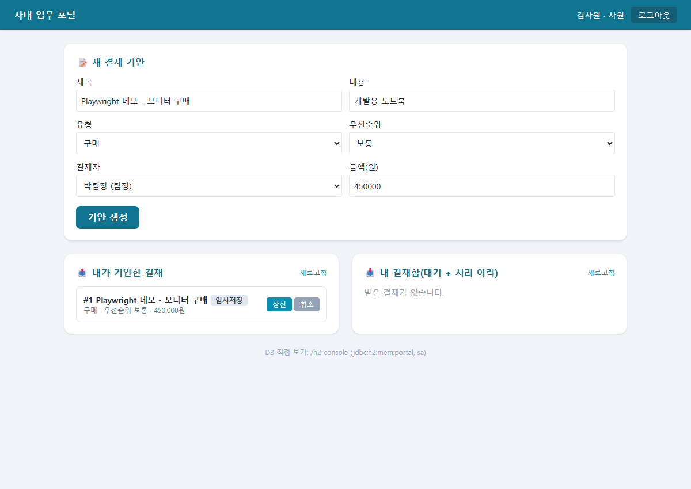
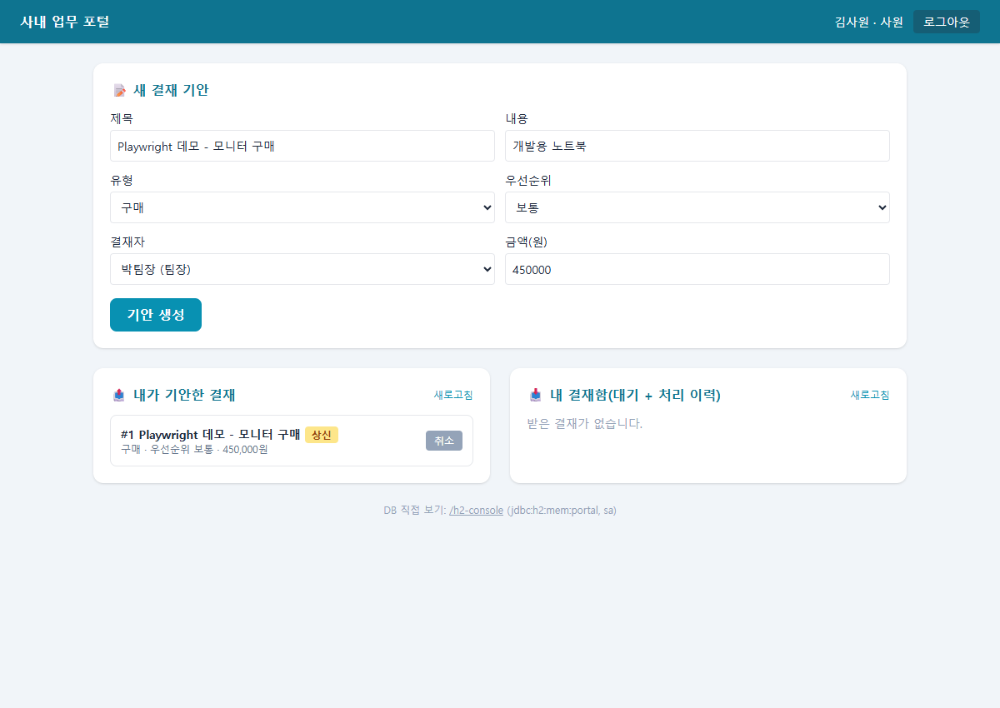
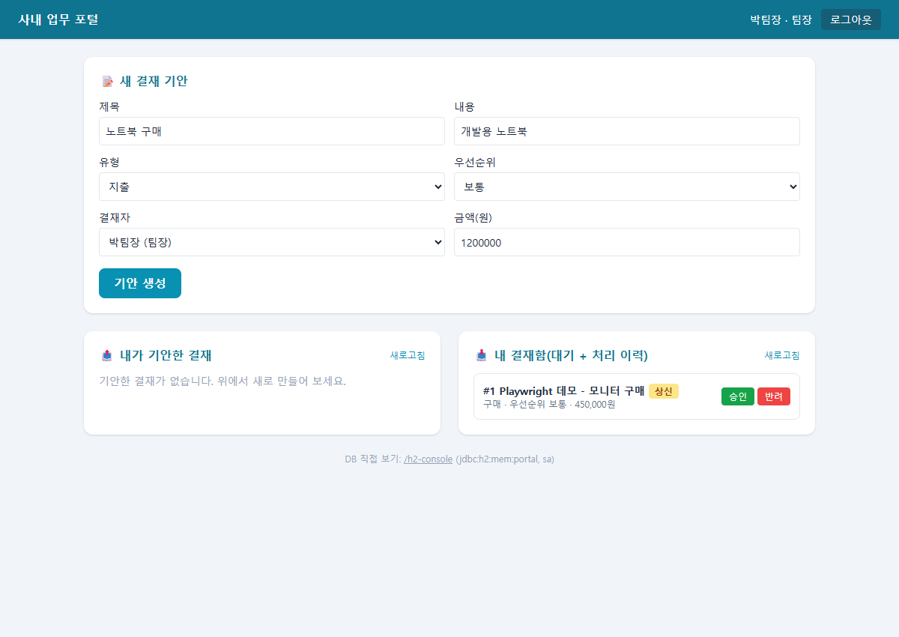
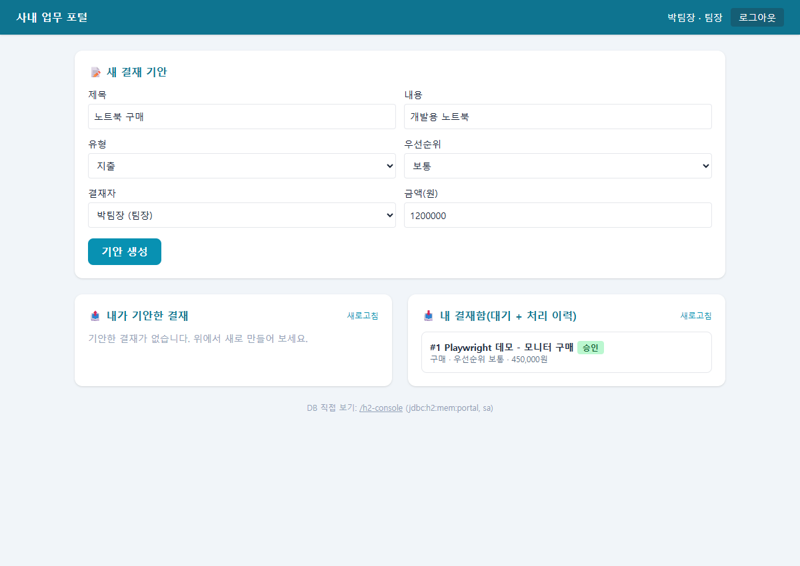

# 사내 업무 포털 (Legacy) - 클린코드 & 리팩토링 실습

「클린코드 & 리팩토링 실전」 과정의 **관통 실습 코드베이스**입니다.
결재 / 공지 / 일정 세 도메인을 가진 Spring Boot 애플리케이션이며, **의도적으로 나쁜 코드(코드 스멜)** 를 심어 두었습니다.
Claude Code 와 함께 **진단 → 안전망(특성화 테스트) → 작은 단계 리팩토링** 순서로 개선해 나가는 과정을 커밋 이력과 문서로 남깁니다.

> 리팩토링 = **내부 구조만 개선하고, 겉보기 동작·계약은 100% 보존**한다.
> API URL · public 메서드 시그니처 · 요청/응답 JSON · DB 저장값 · "조용히 무시" 같은 레거시 동작까지 그대로 둔다. 자세한 규칙은 [`CLAUDE.md`](CLAUDE.md).

---

## 목차

1. [진행 현황](#1-진행-현황)
2. [화면으로 보는 결재 흐름](#2-화면으로-보는-결재-흐름)
3. [기술 스택 · 실행](#3-기술-스택--실행)
4. [시스템 개요](#4-시스템-개요)
5. [진단 문서](#5-진단-문서)
6. [안전망 - 특성화 테스트](#6-안전망---특성화-테스트)
7. [리팩토링 이력](#7-리팩토링-이력)
8. [정적 분석 - SonarQube](#8-정적-분석---sonarqube)
9. [작업 방식 · 규칙](#9-작업-방식--규칙)
10. [다음 단계](#10-다음-단계)

---

## 1. 진행 현황

```
[진단 01~08] ──▶ [안전망 60개] ──▶ [리팩토링 ①이름 ②enum ③라벨 ④분해 ⑤주입 ⑥계층 ⑦DTO ⑧등급 enum ⑨감사 로그 일원화 ⑩Rich Domain] ──▶ (다음) B05 메일 · B03 나머지 · B09
     완료              완료                                     완료 (결재 중심 · 감사 로그는 세 서비스 공통)
```

| 구분 | 상태 | 내용 |
|---|:---:|---|
| 진단 | ✅ | 구조 · 중복 · 긴 메서드 · 매직넘버 · 강결합 · 심각도 2종 · 백로그 ([docs/진단](docs/진단)) |
| 스멜 목록 | ✅ | 16종 S01~S16 ([docs/smells.md](docs/smells.md)) |
| 특성화 테스트 | ✅ | **60개 green** - 결재 33 (서비스 25 · API 8) · 공지 10 · 일정 17. 메일·감사 로그·API JSON 까지 고정 (+ 메일 단위 테스트 6) |
| 이름 개선 (S09) | ✅ | `ApprovalService` 약어 전부 제거 · Notice/Schedule 일부 |
| status enum (S03) | ✅ | 결재 status → `ApprovalStatus` + `AttributeConverter` (DB 정수 그대로) |
| 라벨 위임 (S11) | ✅ | `statusLabel` 5분기 if → `ApprovalStatus.label()` |
| `processApproval` 분해 (S02) | ✅ | guard clause 조기 반환 + submit/approve/reject/cancel 추출 · 86줄·중첩 5 → 22줄·중첩 1 (B04) |
| 생성자 주입 (S04) | ✅ | 메일·감사 로거 직접 `new` 5곳 → `MailSender`·`AuditLogger` 인터페이스 주입 (B02) |
| 계층별 패키지 | ✅ | `approval` → `controller` · `service` · `domain` · `repository` 하위 패키지 (Move Class) |
| 요청/응답 DTO (S07) | ✅ | `Map` 요청·엔티티 응답 → `CreateApprovalRequest`·`ProcessRequest`·`ApprovalResponse` record (B08) |
| 금액 등급 enum (S06) | ✅ | `amountGrade` 의 if 사슬·매직넘버 → `AmountGrade` enum 으로 Move Method |
| 메일 본문 추출 | ✅ | `submit`·`approve`·`reject` 의 본문 조립 → `submittedBody`·`approvedBody`·`rejectedBody` (Extract Method) |
| 구현체 이름 | ✅ | `SmtpMailSender`·`FileAuditLogger` → 실제 동작대로 `ConsoleMailSender`·`ConsoleAuditLogger` (Rename Class) |
| 감사 로그 일원화 (S05) | ✅ | 세 서비스 6곳의 시각 포맷·문자열 조립 → `AuditLogger.write(action, id, userId)`, 포맷은 `ConsoleAuditLogger` 한 곳 (B05 일부) |
| Rich Domain (S06) | ✅ | 상태 전이 규칙을 `Approval` 행위(`draft`·`submit`·`approve`·`reject`·`cancel`)로 이동 - Tell, Don't Ask (B06) |
| 동작 보존 확인 | ✅ | 위 리팩토링 전부 거친 뒤 `./mvnw test` 66개 green (특성화 60 + 단위 6) - 특성화 테스트 본문은 컴파일용 import·`@Import` 줄 외 무수정 |

---

## 2. 화면으로 보는 결재 흐름

> 아래 화면은 Playwright 로 브라우저를 자동 조작해 찍은 실제 실행 화면이다 (리팩토링 후 코드 `ed87f3a` 기준).
> 시나리오: **김사원(사원)이 모니터 구매 결재를 올리고 → 박팀장(팀장)이 승인한다.**

### ① 로그인 - 사용자만 고르면 된다

데모용이라 비밀번호가 없다. 목록에서 사용자를 고르고 **로그인** 을 누른다.



### ② 기안 생성 - 결재 문서를 만든다 (상태: 임시저장)

김사원이 제목 · 유형(구매) · 결재자(박팀장) · 금액(450,000원)을 넣고 **기안 생성** 을 누른다.
아직 결재자에게 가지 않은 **임시저장** 상태다 (DB status = `0`).



### ③ 상신 - 결재자에게 올린다 (상태: 상신)

**상신** 버튼을 누르면 배지가 노란 **상신** 으로 바뀐다 (status `0 → 1`).
이 순간 결재자에게 `[결재요청]` 메일이 가고(실습용이라 콘솔 출력), 감사 로그가 남는다.
상신된 결재는 기안자가 **취소** 할 수 있다.



### ④ 결재함 - 결재자에게 도착

박팀장으로 다시 로그인하면 **내 결재함** 에 방금 결재가 **승인 / 반려** 버튼과 함께 보인다.
버튼은 상신 상태이고, 내가 결재자일 때만 나온다.



### ⑤ 승인 - 결재 완료 (상태: 승인)

**승인** 을 누르면 배지가 초록 **승인** 으로 바뀌고 처리 이력으로 내려간다 (status `1 → 2`).
기안자에게 `[결재승인]` 메일이 간다. 승인된 결재는 더 이상 어떤 처리도 되지 않는다.



### 화면 버튼 ↔ API ↔ 코드 한눈에

| 화면에서 누른 것 | 호출되는 API | 서비스 코드 | 상태 변화 (DB 값) |
|---|---|---|---|
| 기안 생성 | `POST /api/approvals` | `ApprovalService.create` | → `0` 임시저장 (`DRAFT`) |
| 상신 | `POST /api/approvals/{id}/process` `{"action":1}` | `processApproval` | `0 → 1` 상신 (`SUBMITTED`) |
| 승인 | 〃 `{"action":2}` | `processApproval` | `1 → 2` 승인 (`APPROVED`) |
| 반려 | 〃 `{"action":3, "reason":…}` | `processApproval` | `1 → 3` 반려 (`REJECTED`) |
| 취소 | 〃 `{"action":9}` | `processApproval` | `0·1 → 9` 취소 (`CANCELED`) |

> 화면의 배지 글자(임시저장·상신·승인·반려·취소)와 숫자는 리팩토링 전후로 똑같다.
> 리팩토링은 **화면에서 보이는 것은 하나도 바꾸지 않고** 코드 안쪽만 고치는 작업이기 때문이다. 이 화면이 리팩토링 후에도 그대로 동작한다는 것이 "동작 보존"의 눈에 보이는 증거다.

---

## 3. 기술 스택 · 실행

| 항목 | 내용 |
|---|---|
| 언어 · 프레임워크 | Java 21 · Spring Boot 3.2 · Spring Data JPA |
| 테스트 | JUnit 5 · AssertJ · `@DataJpaTest` · JaCoCo |
| DB | MariaDB(localhost:3306, db=portal) - 없으면 **H2 인메모리로 자동 전환** |
| 빌드 | Maven Wrapper (`mvnw`) - Maven 설치 불필요 |
| 정적 분석 | SonarQube Community Build 26.6 (로컬, 도커 없이) |
| 화면 | `src/main/resources/static/index.html` 한 장 (Tailwind + 순수 JS) |

### 사전 준비
- JDK 21 이상
- (선택) MariaDB - 계정 `portal` / `portal1234`. 없어도 H2 로 자동 실행된다
- Claude Code CLI

### 실행

```bat
.\mvnw.cmd spring-boot:run
```

- `DataSourceConfig` 가 시작할 때 DB 를 고른다. 로그에 `>> DB = MariaDB` 또는 `>> MariaDB 연결 불가 → H2 인메모리로 실행` 이 찍힌다.
- 화면: http://localhost:8080 (비밀번호 없이 사용자만 선택해 로그인)
- H2 콘솔: http://localhost:8080/h2-console (JDBC URL `jdbc:h2:mem:portal`, 사용자 `sa`)

### 테스트

```bat
.\mvnw.cmd test
```

- H2 인메모리로 돌며, JaCoCo 리포트가 `target/site/jacoco/` 에 생긴다.

### API 빠른 확인

```bash
# 1) 결재 생성 (기안자=1 김사원, 결재자=2 박팀장, 지출 120만원)
#    Windows Git Bash 는 한글 JSON 이 깨져 400 이 나므로 예시 값은 영문
curl -X POST localhost:8080/api/approvals -H "Content-Type: application/json" \
  -d '{"title":"Laptop","content":"for dev","type":1,"priority":2,"drafterId":1,"approverId":2,"amount":1200000}'

# 2) 상신 (action=1) - 지출 100만원 이상이라 priority 가 3(높음)으로 오른다
curl -X POST localhost:8080/api/approvals/1/process -H "Content-Type: application/json" \
  -d '{"userId":1,"action":1}'

# 3) 승인 (action=2, 박팀장)
curl -X POST localhost:8080/api/approvals/1/process -H "Content-Type: application/json" \
  -d '{"userId":2,"action":2}'

# 4) 목록
curl localhost:8080/api/approvals/drafts/1
curl localhost:8080/api/approvals/inbox/2
```

### 초기 사용자 (`DataSeeder`)

| id | 이름 | role | 의미 |
|:---:|---|:---:|---|
| 1 | 김사원 | 1 | 사원 |
| 2 | 박팀장 | 2 | 팀장 (승인 권한) |
| 3 | 이임원 | 3 | 임원 |
| 4 | 최사원 | 1 | 사원 |

---

## 4. 시스템 개요

### 패키지 구조

```
kr.hull.portal
├── approval/              결재 - 계층별 하위 패키지
│   ├── controller/        ApprovalController            표현(Web/API)
│   ├── dto/               CreateApprovalRequest · ProcessRequest · ApprovalResponse   요청/응답 record (엔티티 비노출)
│   ├── service/           ApprovalService               애플리케이션(서비스)
│   ├── domain/            Approval · ApprovalStatus · ApprovalStatusConverter · AmountGrade   도메인(엔티티·행위·값 타입·DB 매핑)
│   └── repository/        ApprovalRepository            영속성(저장소)
├── notice/     공지 - Entity · Repository · Service (컨트롤러 없음, API 미노출)
├── schedule/   일정 - Entity · Repository · Service (컨트롤러 없음, API 미노출)
├── user/       사용자 - Entity · Repository · Controller
├── common/     MailSender · AuditLogger (인터페이스) ← ConsoleMailSender · ConsoleAuditLogger (@Component, 실습용 콘솔 출력 · 감사 로그 포맷의 유일한 위치)
├── DataSourceConfig  MariaDB ↔ H2 자동 선택
└── DataSeeder        초기 사용자 4명
```

- 결재 도메인만 계층별로 나눴다. 공지·일정·사용자는 아직 한 폴더에 Entity·Repository·Service 가 함께 있다.
- 의존 방향은 `controller → service → repository → domain` 한 방향이다. 서비스는 메일·로그를 **인터페이스**로만 알고, 구현은 스프링이 생성자로 주입한다.

### REST API (보존 대상 - 리팩토링 중 변경 금지)

| 메서드 | URL | 설명 |
|---|---|---|
| POST | `/api/approvals` | 결재 생성 (status 0 임시저장) |
| POST | `/api/approvals/{id}/process` | 처리 - `action` 1 상신 · 2 승인 · 3 반려 · 9 취소 |
| GET | `/api/approvals/drafts/{userId}` | 내가 기안한 결재 |
| GET | `/api/approvals/inbox/{userId}` | 내가 결재자인 결재 |
| GET | `/api/users` | 사용자 목록 |

### 결재 상태 전이 (`processApproval`)

```
                 1 상신 (임시저장일 때)            2 승인 (결재자 본인 · 팀장 이상)
  [0 임시저장] ─────────────────────▶ [1 상신] ──────────────────────────▶ [2 승인]
       │                                │  └──── 3 반려 (결재자 본인 · 팀장 이상) ──▶ [3 반려]
       │ 9 취소 (기안자 본인)            │ 9 취소 (기안자 본인)
       └────────────────────────────────┴───────────────────────────────▶ [9 취소]
```

| action | 전제조건 | 결과 | 부수 효과 |
|:---:|---|:---:|---|
| 1 상신 | status 0 (요청자 확인 없음) | 1 | 지출(type 1) & 100만원 이상이면 priority 3 · 결재자에게 메일 · 감사 로그 |
| 2 승인 | status 1 · 요청자 = 결재자 · role ≥ 2 | 2 | 기안자에게 메일 · 감사 로그 |
| 3 반려 | status 1 · 요청자 = 결재자 · role ≥ 2 | 3 | rejectReason 저장 · 기안자에게 메일 · 감사 로그 |
| 9 취소 | status 0 또는 1 · 요청자 = 기안자 | 9 | 감사 로그 (메일 없음) |

- 조건이 하나라도 맞지 않으면 **예외 없이 조용히 무시**한다 (응답 200, 변화 없음). 레거시의 설계 결함이지만 **리팩토링 단계에서는 보존**하고, 리팩토링 완료 후 재설계 단계에서 다룬다.
- 승인(2) · 반려(3) · 취소(9)는 종료 상태 - 어떤 action 도 효과가 없다.

---

## 5. 진단 문서

리팩토링 전에 레거시를 관점별로 진단했다. 각 문서 맨 위에 "무엇을 · 왜 보는지"를 적어 두었다.

| 문서 | 내용 | 핵심 결과 |
|---|---|---|
| [01 구조 파악](docs/진단/01-구조-파악.md) | 패키지 · 외부 계약(API·DB값) · 서비스별 책임 | `ApprovalService` 가 7가지 책임을 떠안은 God Class |
| [02 중복 코드](docs/진단/02-중복-코드.md) | 세 서비스의 중복 9유형 (D1~D9) | 감사 로그 6곳 · 메일 본문 4곳 · 합칠 때 사라지기 쉬운 미묘한 차이 표시 |
| [03 긴 메서드](docs/진단/03-긴-메서드.md) | 메서드 길이 · 중첩 깊이 측정 | `processApproval` 86줄 · 중첩 5 |
| [04 매직넘버](docs/진단/04-매직넘버.md) | 숫자 리터럴 의미 추정 · enum 이름 제안 | 도메인 코드값 8종 · action ≠ status · `1000000` 두 의미 |
| [05 강결합](docs/진단/05-강결합.md) | 직접 `new` 의존성 | 메일·로거 직접 생성 5곳 → DIP 목표 구조 |
| [06 심각도 표](docs/진단/06-심각도-표.md) | 영향 × 범위 → 처리 순서 | 치명 4건: S01 · S02 · S03 · S04 |
| [07 심각도 점수](docs/진단/07-심각도-점수.md) | 영향 × 수정난이도 → ★ | ★5 S02 · 빠른 성과 S04 |
| [08 리팩토링 백로그](docs/진단/08-리팩토링-백로그.md) | 우선순위 순 작업 B01~B10 · 완료 조건(DoD) | B01 테스트 → B02 DIP → B03 enum → B04 분해 … |
| [smells.md](docs/smells.md) | 스멜 16종 종합 체크리스트 | ID(S01~S16)로 커밋·주석에서 참조 |

### 스멜 심각도 요약

| 등급 | 스멜 |
|---|---|
| 🔴 치명 | S01 테스트 부재 · S02 God Class/Long Method · S03 매직넘버 · S04 강결합 |
| 🟠 높음 | S05 중복 코드 · S06 빈약한 도메인 · S07 DTO 부재 |
| 🟡 중간 | S08 깊은 중첩 · S09 나쁜 이름 · S10 긴 파라미터 목록 |
| 🟢 낮음 | S11 표현 로직 · S13 주석 스멜 · S14 `LocalDateTime.now()` · S15 매직 문자열 · S16 계층 건너뛰기 |
| ⚪ 보존 | S12 조용한 실패 · `null` 반환 - 동작 변경이므로 재설계 단계로 |

---

## 6. 안전망 - 특성화 테스트

리팩토링 전에 **현재 동작을 옳고 그름 판단 없이 그대로 고정**했다. 결과 상세는 [docs/특성화 테스트 결과.md](docs/특성화%20테스트%20결과.md).

| 테스트 클래스 | 개수 | 고정한 동작 |
|---|:---:|---|
| `ApprovalServiceTest` | 6 | 상신→승인 · 반려 · 취소 · 권한 없는 승인 무시 · 없는 id 무시 · 재승인 무시 |
| `ApprovalServiceBranchCharacterizationTest` | 14 | 금액 기준 우선순위 상향 · 당사자/권한 확인 · 상태 가드 · 정의 밖 action · 없는 사용자 · `statusLabel` 라벨 · `amountGrade` 경계값 |
| `ApprovalSideEffectCharacterizationTest` | 5 | 상신 메일(수신자·제목·본문)과 감사 로그 형식 · 999,999원 경계 · 긴급 생성 · 결재자 아닌 반려는 메일·로그 없음 · 상신 전 취소 로그 |
| `ApprovalApiCharacterizationTest` | 8 | MockMvc - 응답 12개 필드·순서·정수 코드 · 생략 기본값 · urgent · 처리 API 200 + 빈 본문 · 조용한 무시도 200 · 반려 사유 `""` · inbox 기준 |
| `NoticeServiceCharacterizationTest` | 10 | 생성 · 게시 권한(팀장↑) · 작성자 아닌 팀장도 게시 · 긴급 공지는 게시자 포함 전 직원 메일 · 재게시 무시 · `statusLabel` |
| `ScheduleServiceCharacterizationTest` | 17 | 검증 실패는 원인 구분 없이 `null` · 시간 겹침 경계(맞닿음·다른 소유자·취소 일정) · 공백 제목·없는 소유자로도 생성 · 확정 · 소유자 없는 확정은 NPE |
| **특성화 합계** | **60** | |
| `ApprovalServiceMailUnitTest` (단위) | 6 | 서비스를 생성자로 직접 조립 - 실제 JPA 저장소 + `FakeMailSender` + `mock(AuditLogger)`. `send` 호출 횟수·수신자·제목·본문, 승인·반려 메일 본문까지 |

| 지표 (`processApproval`, 3차는 분해 후 위임 메서드 4개 포함) | 1차 (6개) | 2차 (20개) | 3차 (33개) |
|---|:---:|:---:|:---:|
| 분기 커버리지 | 29/48 (60.4%) | 42/48 (87.5%) | **42/48 (87.5%)** |
| 라인 커버리지 | 58/60 | 59/59 (100%) | **73/73 (100%)** |
| 검증 대상 | 상태 | 상태·우선순위·사유 | + 메일·감사 로그·API JSON |

- **작성 규칙:** 서비스 테스트는 `@DataJpaTest` + `@Import` 로 서비스를 주입받고(생성자가 바뀌어도 본문 무수정), API 테스트는 `@SpringBootTest` + MockMvc 로 전체를 띄워 테스트마다 롤백한다. 메일·로그는 테스트 전용 가짜(`RecordingMailSender`·`RecordingAuditLogger`)를 주입해 검증한다. 데이터는 `service.create` 로 만든다. 기대값은 **정수 리터럴(0/1/2/3/9)**. 필드·변수는 영어, 메서드명만 한글 시나리오.
- **불변 규칙:** 한번 만든 테스트의 본문(호출·기대값)은 리팩토링 중 **절대 수정하지 않는다.** `ApprovalServiceTest.java` 는 생성 커밋(`a93dd56`) 이후 **컴파일용 줄만** 바뀌었다 - B02 의 `@Import` 1줄 + import 2줄, 계층 패키지 이동의 import 3줄 추가. 테스트 메서드·호출·기대값 줄은 생성 시점과 완전히 같다.
- **레거시 검증:** 2차 14개와 API 8개는 리팩토링 전 코드(`53a532a`)에서도 같은 기대값으로 green - "레거시의 원래 동작"을 고정했다는 증거다.
- **이상한 동작도 기록:** 공지·일정 테스트는 "작성자 아닌 팀장도 게시", "공백 제목으로 생성", "소유자 없는 확정은 NPE" 처럼 결함으로 보이는 현재 동작도 그대로 고정했다 - 고치는 것은 재설계 단계.
- **운영 포맷 그대로 검증:** 테스트용 `RecordingAuditLogger` 는 `ConsoleAuditLogger` 를 상속해 포맷을 물려받고 출력만 바꾼다. 그래서 테스트가 검증하는 로그 문자열이 곧 운영 포맷이다.
- **남은 빈틈:** 메일 수신자·결재자·기안자가 null 인 분기와 `statusLabel` null 방어 (7개) - 엔티티를 직접 조작해야 만들 수 있어 낮은 우선순위.

---

## 7. 리팩토링 이력

각 단계는 **기법 하나 → 테스트 green → 커밋** 단위로 진행했다. 바꾼 코드에는 `[리팩토링] 레거시 X → Y (기법 · 이유)` 주석을 남겼다.

| 커밋 | 단계 | 기법 | 내용 |
|---|---|---|---|
| `a93dd56` | 안전망 | Characterization Test | 특성화 테스트 6개 |
| `ea258b9` | ① 이름 | Rename Variable (S09) | `d`→`approval`, `u`→`user`, `s`→`status`, 임시변수 `proc` 제거 |
| `352c127` | ① 이름 | Rename Variable/Field (S09) | `repo`·`mail`·`audit`·`tmp`·`a`·`act` 등 `ApprovalService` 약어 전부 |
| `20b9d34` | ② enum | Replace Magic Number with Enum (S03) | `ApprovalStatus`(DRAFT=0 · SUBMITTED=1 · APPROVED=2 · REJECTED=3 · CANCELED=9) + `AttributeConverter` |
| `8d7a0c6` | ③ 라벨 | 조건문 → enum 소유 (S11) | `statusLabel` 의 임시변수 + 5분기 if → `ApprovalStatus.label()` 위임 |
| `34dd3b9` | 안전망 보강 | Characterization Test | 분기 특성화 테스트 14개 · 커버리지 87.5% |
| `25a4163` | ④ 분해 | Guard Clause · Extract Method (S02 · B04) | `processApproval` 의 조회 실패를 조기 반환, 분기를 `submit`·`approve`·`reject`·`cancel` 로 추출하고 내부 중첩 if 도 조기 반환으로 평탄화 |
| `1b0894d` | ⑤ 주입 | Extract Interface · Constructor Injection (S04 · B02) | `MailSender`·`AuditLogger` 인터페이스 추출, 구현은 `@Component`, 세 서비스의 직접 `new` 5곳 → 생성자 주입. 테스트는 `@Import` 줄만 조정(확인받음) |
| `5c9e1b2` | 안전망 보강 | Characterization Test | 메일·감사 로그 5개 + API JSON(MockMvc) 8개 → 전체 33개 |
| `b94d574` | ⑥ 계층 패키지 | Move Class | `approval` 6개 클래스를 `controller`·`service`·`domain`·`repository` 로 이동. package·import 만 변경, 테스트는 import 줄 추가만 |
| `9385535` | ⑦ DTO | Introduce Parameter Object · Replace Entity with DTO (S07 · B08) | 요청 `Map<String,Object>` → `CreateApprovalRequest`·`ProcessRequest`, 응답 엔티티 → `ApprovalResponse`. 생략 기본값은 compact 생성자(amount 0 · urgent false · reason `""`), 필수 필드는 래퍼 타입이라 누락 시 레거시처럼 500 |
| `8d703ce` | ⑧ 등급 enum | Move Method (S06 · B06) | `amountGrade` 의 금액 하한 if 사슬 → `AmountGrade` enum(S·A·B·C 하한 소유), 서비스는 위임만 |
| `c5f81f5` · `58eab01` | 메일 본문 | Extract Method | 상신·승인·반려 메일 본문 조립 → `submittedBody`·`approvedBody`·`rejectedBody` (서비스 private) |
| `96e066c` | 구현체 이름 | Rename Class | `SmtpMailSender`→`ConsoleMailSender`, `FileAuditLogger`→`ConsoleAuditLogger` (하는 일 그대로). 서비스 코드 변경 없음 - 인터페이스 의존 덕분 |
| `2fdc52b` | 안전망 보강 | Characterization Test | 공지 10개 · 일정 17개 → 특성화 60개 |
| `ec1a3a4` | ⑨ 감사 로그 일원화 | Extract/Move Method (S05 · B05) | `AuditLogger.write(action, id, userId[, detail])` 추가, 세 서비스 6곳의 포맷 조립·`writeAudit` 제거. `APPROVAL CREATE` 의 ` type=…` 꼬리는 detail 로 보존 |
| `ebd0724` | 단위 테스트 | Fake · Mock | `FakeMailSender` 로 `send` 호출 검증 6개 |
| `8ee835a` | ⑩ Rich Domain | Tell, Don't Ask · Move Method (S06 · B06) | `Approval.draft` 정적 팩토리 + `submit`·`approve(user)`·`reject(user, reason)`·`cancel(userId)` 가 판단·상태 변경·updatedAt 을 책임. 서비스는 호출 후 `true` 일 때만 저장·메일·로그 |

### `processApproval` 분해 전후

```java
// 레거시 - 한 메서드 86줄, 중첩 5단계
if (proc == 2) {
    if (s == 1) {
        if (d.getApproverId() != null && d.getApproverId().equals(userId)) {
            if (u.getRole() >= 2) {
                d.setStatus(2); ...
                if (drafter != null) { mail.send(...); }

// 리팩토링 후 - processApproval 은 조회 가드 + 위임만
public void processApproval(Long id, Long userId, int action, String reason) {
    Approval approval = approvalRepository.findById(id).orElse(null);
    if (approval == null) { return; }
    User user = userRepository.findById(userId).orElse(null);
    if (user == null) { return; }

    if (action == 1)      { submit(approval, userId); }
    else if (action == 2) { approve(approval, user, userId); }
    else if (action == 3) { reject(approval, user, userId, reason); }
    else if (action == 9) { cancel(approval, userId); }
}

private void approve(Approval approval, User user, Long userId) {
    if (approval.approvalStatus() != ApprovalStatus.SUBMITTED) { return; }                            // 상태
    if (approval.getApproverId() == null || !approval.getApproverId().equals(userId)) { return; }     // 당사자
    if (user.getRole() < 2) { return; }                                                               // 권한
    approval.changeStatus(ApprovalStatus.APPROVED); ...
}
```

| 메서드 | 줄 수 (주석 포함 / 코드만) | 중첩 |
|---|:---:|:---:|
| `processApproval` | 86 / 75 → **22 / 19** | 5 → **1** |
| `submit` · `approve` · `reject` · `cancel` | 22 · 23 · 25 · 14 (코드 19 · 21 · 23 · 13) | 1 |

- 조건이 맞지 않으면 예외 없이 `return` 하는 레거시 동작, 메일 문구, 감사 로그 행위명, 처리 순서(상태 → updatedAt → save → 메일 → 로그)는 그대로다. 메일 문구는 직전 커밋과 한 줄씩 대조했다.
- `approve` 와 `reject` 의 가드 3줄, 메서드마다 반복되는 메일 본문 조립은 아직 중복이다 - B05 에서 공통화한다.

### Rich Domain 전환 전후 (Tell, Don't Ask)

```java
// 전 - 서비스가 엔티티 값을 꺼내 판단(ask)하고 setter 로 바꿈
if (approval.approvalStatus() != ApprovalStatus.SUBMITTED) { return; }
if (approval.getApproverId() == null || !approval.getApproverId().equals(userId)) { return; }
if (user.getRole() < 2) { return; }
approval.changeStatus(ApprovalStatus.APPROVED);
approval.setUpdatedAt(LocalDateTime.now());

// 후 - 서비스는 시키기만(tell), 엔티티가 판단·변경·시각 갱신을 책임
if (!approval.approve(user)) { return; }      // false = 레거시의 조용한 무시
approvalRepository.save(approval);             // 성공했을 때만 저장·메일·감사 로그
```

| 위치 | 책임 |
|---|---|
| `Approval.draft(...)` | 시작 상태 DRAFT · 긴급이면 priority 3 · 생성 시각 |
| `Approval.submit()` | DRAFT 일 때만 · 지출 100만원↑ 이면 priority 3 |
| `Approval.approve(user)` / `reject(user, reason)` | SUBMITTED · 결재자 본인 · 팀장 이상 (공통 가드 `canBeDecidedBy`) |
| `Approval.cancel(userId)` | DRAFT·SUBMITTED · 기안자 본인 |
| `ApprovalService` | 조회 · 행위 호출 · 성공 시 저장 · 메일 · 감사 로그 (조율만) |

- 서비스에서 `ApprovalStatus` 비교·`setStatus`·`setUpdatedAt`·`getRole() < 2` 가 사라졌다. 상태는 이제 도메인 행위로만 바뀐다 (서비스 전용 `changeStatus` 삭제).
- `Approval` 의 public getter/setter 는 계약 보존을 위해 남겼다 - 외부에서 상태를 바꾸는 통로(`setStatus(int)`) 를 막는 것은 재설계 단계.

### DTO 전환에서 지킨 계약

```java
// 레거시 - Map 캐스팅, 엔티티를 그대로 응답
public Approval create(@RequestBody Map<String, Object> body) {
    return service.create((String) body.get("title"), ..., (int) body.get("type"), ...,
            ((Number) body.getOrDefault("amount", 0)).longValue(), (boolean) body.getOrDefault("urgent", false));
}

// 리팩토링 후 - record 요청 · 응답 전용 record
public ApprovalResponse create(@RequestBody CreateApprovalRequest request) {
    return ApprovalResponse.from(service.create(request.title(), ..., request.amount(), request.urgent()));
}

public record ProcessRequest(Long userId, Integer action, String reason) {
    public ProcessRequest {
        if (reason == null) { reason = ""; }   // 레거시 getOrDefault("reason", "")
    }
}
```

| 확인 항목 | 결과 |
|---|---|
| 특성화 테스트 | 33개 green, 테스트 파일 무수정 (API 8개가 응답 필드·순서·정수 코드·기본값을 고정) |
| 이전 코드와 HTTP 응답 비교 | 이전 코드(`3fc64a8`, :8081)와 새 코드(:8080)에 같은 요청 11건 - 생성 3 · 처리 4 · 목록 2 는 **바이트 단위 동일** |
| 오류 경계 | `type`·`action` 누락 → 둘 다 **500** (같은 NullPointerException, 트레이스의 위치 문구만 다름) |
| 서비스 시그니처 | 변경 없음 - 컨트롤러가 DTO 를 풀어서 기존 메서드 호출 |

> **잘못된 입력에서의 미세한 차이:** `"reason": null` 을 명시하면 레거시는 `null`, 지금은 `""` 로 저장한다(compact 생성자). `"type": "1"`·`1.5` 처럼 형식이 틀린 숫자는 레거시가 캐스팅 오류 500 이었지만 지금은 Jackson 이 숫자로 받아들일 수 있다. 화면(`index.html`)의 정상 요청에는 영향이 없다.

### enum 전환에서 지킨 계약

```java
// Approval.java - DB 엔 정수 그대로, 서비스는 enum 으로
@Convert(converter = ApprovalStatusConverter.class)
@Column(nullable = false)
private ApprovalStatus status = ApprovalStatus.DRAFT;

public int getStatus() { return status.getCode(); }          // [보존] 응답 JSON "status": 0/1/2/3/9
public ApprovalStatus approvalStatus() { return status; }    // 서비스용 - get 접두가 없어 JSON 에 안 나온다
```

| 확인 항목 | 결과 |
|---|---|
| DB 저장값 | `STATUS = 0, 1, 2, 3, 9` · 컬럼 `INTEGER NOT NULL` (레거시 `int` 와 동일) |
| API 응답 JSON | 필드·순서 동일, `"status"` 는 정수 - 화면(index.html) 무수정 동작 |
| 특성화 테스트 | 본문 무수정 green (당시 20개, 현재 33개) |
| `@Enumerated` | 사용하지 않음 - `ORDINAL` 은 CANCELED(9)를 4로, `STRING` 은 문자로 저장해 DB 값이 깨진다 |

> **알려진 차이 1가지:** 정의 밖 code(예: `setStatus(5)`)는 레거시에선 그대로 저장됐지만 이제 `IllegalArgumentException` 이 난다. API·서비스는 0/1/2/3/9 만 쓰므로 실제 흐름에선 생기지 않는 경우다.

---

## 8. 정적 분석 - SonarQube

로컬 SonarQube Community Build 26.6 (Java 21, 도커 없이 · 한글팩 적용)로 **리팩토링 전 베이스라인**을 측정했다.

```bat
.\mvnw.cmd sonar:sonar -Dsonar.host.url=http://localhost:9000 -Dsonar.token=<토큰> ^
  -Dsonar.projectKey=legacy-portal -Dsonar.scanner.skipJreProvisioning=true
```

| 지표 | 베이스라인 |
|---|---|
| 코드 줄 수 | 653 |
| 버그 | 0 (신뢰성 A) |
| 취약점 | 3 (보안 E) - DB 비밀번호 하드코딩 (`DataSourceConfig`) |
| 코드 스멜 | 37 (기술 부채 290분) |
| 인지 복잡도 | 100 - `processApproval` 하나가 **52** (허용 15) |
| 중복 | 1.3% |
| 커버리지 | 0% (테스트 작성 전) |

| 규칙 | 건수 | 대응 스멜 |
|---|:---:|---|
| S8688 `now()` 시간대 미지정 | 13 | S14 |
| S1066 합칠 수 있는 중첩 if | 9 | S02 · S08 |
| S106 `System.out` | 9 | S04 주변 |
| S6437 · S2068 비밀번호 하드코딩 | 3 | S15 |
| S3776 · S6541 인지 복잡도 · Brain Method | 2 | **S02** |
| S6880 if 사슬 → switch | 2 | S11 |
| S107 파라미터 8개 · S1192 리터럴 중복 | 2 | S10 · S05 |

> SonarQube 는 매직넘버(S03)·직접 `new`(S04)·빈약한 도메인(S06)·DTO 부재(S07) 같은 **설계 수준 스멜은 잡지 못했다** - 진단 문서가 따로 필요한 이유.
> 첫 분석에서 스캐너의 JRE 자동 다운로드가 실패해 `-Dsonar.scanner.skipJreProvisioning=true` 로 로컬 Java 21 을 쓰게 했다.

---

## 9. 작업 방식 · 규칙

### 리팩토링 불변 규칙 ([CLAUDE.md](CLAUDE.md))

| 보존 대상 (절대 안 바꿈) | 개선 대상 (내부 구조) |
|---|---|
| API URL·HTTP 메서드 (`/api/approvals/{id}/process` 하나 유지) | 매직넘버 → 도메인 이름 enum |
| public 메서드 시그니처 (`processApproval(id, userId, action, reason)`) | 직접 `new` → 생성자 주입 (DIP) |
| 요청/응답 JSON 구조·숫자 코드 | Entity 노출 → 요청/응답 DTO(record) |
| DB 저장값 (enum 이어도 정수, `AttributeConverter`) | 긴 메서드 분리 · 중복 제거 · Rich Domain |
| 조용한 무시 · `null` 반환 같은 레거시 동작 | 약어 → 의미 있는 이름 |

- 특성화 테스트 본문(호출·기대값)은 **절대 수정 금지**. 예외는 패키지 이동에 따른 import·`@Import` 같은 컴파일용 기계적 수정뿐이며, 그 diff 는 따로 확인받는다.
- 이름: 약어·한 글자 금지 (지역변수·파라미터 포함), boolean 은 `is`/`has`, enum 은 `ApprovalStatus` 처럼 도메인을 드러내는 이름.

### 커밋 · 푸시

- 커밋 메시지에 스멜/백로그 ID 표기 - 예: `refactor: 결재 status int → ApprovalStatus enum + AttributeConverter [S03]`
- 이 PC 의 `.git/hooks/post-commit` 훅이 **커밋 직후 `origin` 으로 자동 push** 한다 (훅은 레포에 포함되지 않음).
- 셸 스크립트는 `.gitattributes` 로 LF 고정 (훅이 CRLF 로 깨지지 않게).

### todo-guard (작업 누락 방지)

- 지시를 받으면 훅이 [`TODO.md`](TODO.md) 에 `#번호` 로 적고, 끝나지 않은 항목이 남으면 턴 종료를 막는다.
- 훅 껍데기는 `.claude/hooks/`, 등록은 `.claude/settings.json`. 사용법은 [`투두가드설명서.md`](투두가드설명서.md).

---

## 10. 다음 단계

[08 리팩토링 백로그](docs/진단/08-리팩토링-백로그.md) 순서 (✅ 완료: B02 · B04 · B06(결재) · B08 · 🔄 진행 중: B01 · B03 · B05 - 진행 상황은 백로그 2절 표):

| 순서 | 항목 | 내용 |
|:---:|---|---|
| 1 | **B05 나머지** | 메일 템플릿 공통화 - 결재 3종(`submittedBody` 등)과 공지 긴급 메일의 인사말·제목 태그 중복 (감사 로그는 완료) |
| 2 | **B09** | `create` 8개 파라미터·`Approval.draft` 8개 → DTO 를 서비스까지만 전달하거나 생성 명령 객체로 (도메인은 DTO 를 모르게, `create(8개)` public 시그니처는 위임으로 보존). `approve`·`reject` 의 `user`·`userId` 중복 인자 정리 |
| 3 | B03 나머지 | action · type · priority · `UserRole`(→ `role >= 2` 를 `hasApprovalAuthority()` 로) · 공지/일정 상태 enum |
| 4 | B07 | 공지·일정 중첩 평탄화·Rich Domain - 특성화 27개가 안전망 |
| 5 | B10 · 기타 | `UserController` 엔티티 응답 → `UserResponse` (먼저 `/api/users` 특성화 테스트) · `ScheduleService.create` 의 `startAt`·`endAt` → `TimeRange` 값 객체 · 남은 정리 |
| 이후 | 재설계 | S12 조용한 실패 → 예외/결과 타입 (동작 변경 - 리팩토링 완료 후 별도 단계) |
